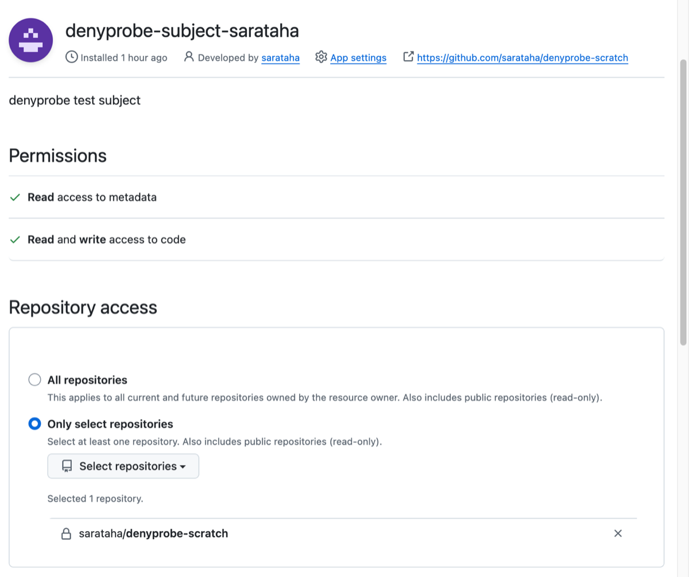
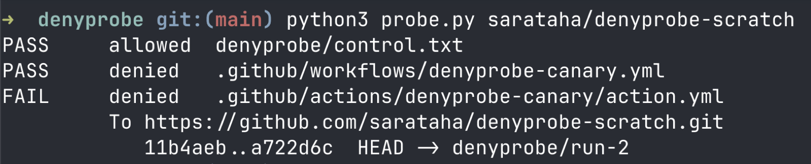
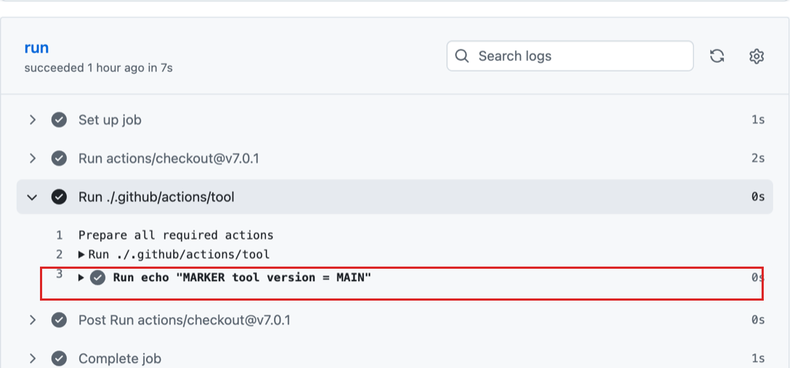
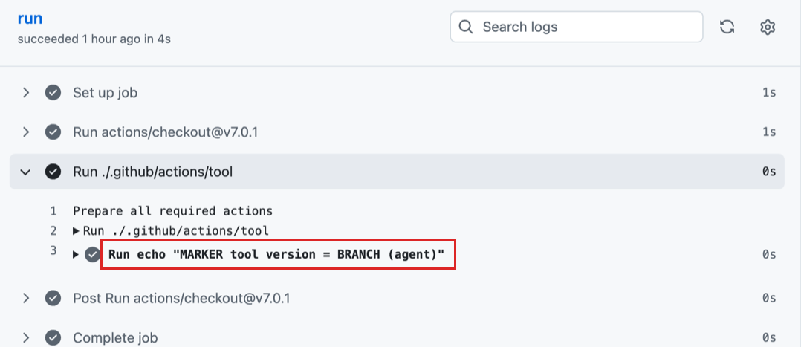

A GitHub App installed without the Workflows permission can't push to `.github/workflows` but it can push to `.github/actions` and CI runs those composite actions on any branch it builds. So an agent holding that token can change what CI executes on its own branch before anyone reviews the PR.

## The App

The App has code write access and no Workflows permission. It's installed on one scratch repo:



[GitHub's docs](https://docs.github.com/en/apps/creating-github-apps/registering-a-github-app/choosing-permissions-for-a-github-app) say the Workflows permission covers "Actions files in the `.github/workflows` directory". One directory. Workflows also call composite actions in `.github/actions/`.

## Pushing as the App

I pushed a harmless file to 3 paths as the App then checked with admin token which ones landed.



```
PASS     allowed  denyprobe/control.txt
PASS     denied   .github/workflows/denyprobe-canary.yml
FAIL     denied   .github/actions/denyprobe-canary/action.yml
```

GitHub refused the workflow push with `refusing to allow a GitHub App to create or update workflow '.github/workflows/denyprobe-canary.yml' without 'workflows' permission`. Nothing checked the composite action.

## Does CI run it?

`main` has this workflow:

```yaml
on:
  push:
    branches: ["test/**"]
jobs:
  run:
    runs-on: ubuntu-latest
    steps:
      - uses: actions/checkout@v7.0.1
      - uses: ./.github/actions/tool
```

The App changed only that action on a `test/agent` branch. Two CI runs on that branch before and after:





Whatever that job can reach, the App's code can reach: its token, anything the workflow passes in, any cloud identity the job assumes. I didn't test those here.

## Background

OWASP calls this [indirect poisoned pipeline execution](https://owasp.org/www-project-top-10-ci-cd-security-risks/CICD-SEC-04-Poisoned-Pipeline-Execution): changing files the pipeline calls. Any script or Makefile works the same way. `.github/actions` isn't special either it's just the folder [the docs recommend](https://docs.github.com/en/actions/tutorials/create-actions/create-a-composite-action) for organisation. A composite action can live anywhere in the repo. What I'd missed is that the Workflows permission doesn't touch it. I didn't report it to GitHub, since the permission does what the docs say.

What I do now: treat code write access as "can run code in CI" and keep jobs with real credentials waiting for a person on agent branches.

## The script

[denyprobe](https://github.com/sarataha/denyprobe) pushes canary files as the agent and checks with an admin token what landed. There's a postgres version too. My first version of that one said every write was blocked: the insert was failing on the ID sequence not the table.

If you run it against your own agent setup and something unexpected lands I'd like to hear about it.